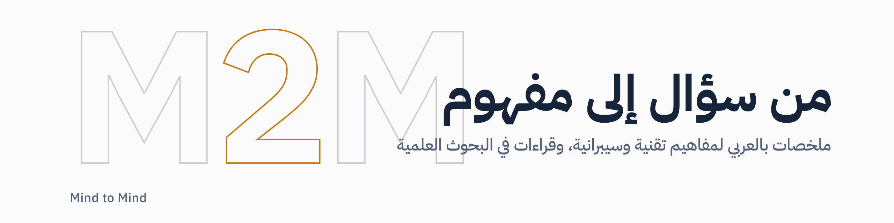

<picture>
  <source media="(prefers-color-scheme: dark)" srcset=".github/assets/banner-dark.png">
  
</picture>

## من سؤال إلى مفهوم

**M2M · Mind to Mind**

العلم يتجدد بين حين وآخر، وفي زماننا هذا تتجدد التقنية بتسارع لا تحدّه حدود, لكن من جعل نفسه في هذا المجال، لا بد أن يبقى مواكبًا، حتى تتسع آفاقه، وتقوى قدرته على اتخاذ القرار.

ومن خلال هذه الصفحة، أحوّل ما هو نصٌّ أمامي إلى معرفة أنقلها إلى شخصك، ونسهم معًا في نشر العلم.

**[زيارة الموقع: leadermojeb.github.io](https://leadermojeb.github.io)**

### الأقسام

- **[ما يبقى](https://leadermojeb.github.io/concepts/)**: الأدوات تتبدّل والإصدارات تتقادم، أما المفاهيم فتبقى, هنا أكتب ما يبقى في "كيفية" عمل المفهوم من الداخل، وكيف يسلك طريقاً مختلفاً عن غايته.
- **[خُطى](https://leadermojeb.github.io/research/)**: كل بحث خطوة في طريق لم يكتمل بعد, حيث أنني أقف عندها لأفهم من أين جاء العلم، وإلى أين يمضي.

### شاركني الطريق

هذا الدفتر مفتوح لمن يرى في العلم ما أراه, إن كتبت ملخصًا لمفهوم تقني أو قراءة في بحث، فلك هنا مساحة تحمل اسمك, راسلني، ونراجعه سويًا قبل النشر.

- **البريد:** majebhome@gmail.com
- **LinkedIn:** [linkedin.com/in/mojeb](https://www.linkedin.com/in/mojeb)

---

معجب العتيبي، محلل وباحث في مجال الأمن السيبراني. المحتوى شخصي لأغراض التعلّم ولا يمثّل أي جهة عمل.

